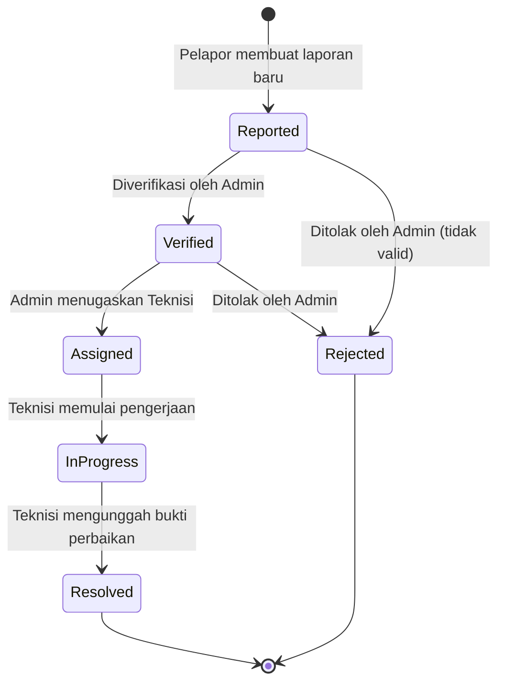

# SiFasilitas (Campus Facility Care)

> Sistem pelaporan dan penanganan kerusakan fasilitas kampus berbasis mobile dengan arsitektur multi-peran (*Pelapor*, *Admin Fasilitas*, dan *Teknisi*), didukung verifikasi berbasis QR Code, *smart triage* AI (Gemini), serta *state machine* pelacakan tiket secara terintegrasi.

---

## 📱 Deskripsi Proyek
**SiFasilitas** adalah aplikasi mobile berbasis Flutter dan Google Firebase yang dirancang untuk mendigitalkan dan mengoptimalkan proses penanganan aduan sarana-prasarana kampus. Sistem ini menggantikan proses pelaporan manual dengan alur kerja yang transparan, terukur (berbasis SLA), dan terhindar dari duplikasi tiket.

Aplikasi menerapkan **Role-Based Access Control (RBAC)** dengan 3 peran utama:
1. **Pelapor (Mahasiswa, Dosen, Staf):** Memindai QR Code lokasi fasilitas, mengambil foto kerusakan fisik, mendapatkan rekomendasi kategori dan prioritas otomatis via AI, serta memantau linimasa perbaikan tiket secara *real-time*.
2. **Admin Fasilitas:** Memverifikasi tiket masuk, menolak aduan yang tidak relevan/valid (*Rejected*), memprioritaskan antrean, dan menugaskan tiket kepada teknisi lapangan yang bertugas (*Assigned*).
3. **Teknisi Perbaikan:** Menerima penugasan tugas kerja, memperbarui status pengerjaan ke tahap pengerjaan (*In Progress*), serta menutup tiket (*Resolved*) dengan kewajiban melampirkan foto bukti hasil perbaikan.

---

## 👥 Anggota Tim & Pembagian Tanggung Jawab

| No | Nama Lengkap | NIM | Peran Utama | Fokus Tanggung Jawab |
|---|---|---|---|---|
| 1 | Wira Hari Pratama | 241402111 | **Project Lead & Core Architecture** | Setup fondasi Flutter & Firebase, perancangan model entitas data, implementasi *state machine engine* & transaksi Firestore, serta standarisasi master data seeder. |
| 2 | Leondo Admiral Purba | 241402053 | **Frontend Dev (Auth & RBAC)** | Implementasi UI & alur autentikasi (Firebase Auth), sistem validasi identitas (NIM/NIP), serta *role-based navigation gate* (Pelapor, Admin, Teknisi). |
| 3 | Aldrik Noel Sianipar | 241402049 | **Frontend Dev (Reporting & Hardware)** | Antarmuka pembuatan tiket laporan, integrasi kamera & kompresi gambar (`image_picker`, `flutter_image_compress`), dan integrasi pemindai QR Code ruangan/aset (`mobile_scanner`). |
| 4 | Rafi Andara Nasution | 241402095 | **Frontend Dev (Tracking & Timeline)** | Antarmuka riwayat aduan, visualisasi tahapan status tiket (*Reported* ➔ *Resolved*), log riwayat perubahan status (*audit trail*), serta konfirmasi penyelesaian oleh pelapor. |
| 5 | Vincent Christian Simbolon | 241402039 | **Frontend Dev (Dashboard Admin/Teknisi)** | Dashboard manajemen antrean tiket masuk bagi Admin & Teknisi: filter kategori & urgensi, alur disposisi teknisi, serta form penyelesaian tiket berlampiran foto sesudah pengerjaan. |
| 6 | Yosia Marcel Simanjuntak | 241402114 | **BaaS, AI Integration & Data Engineer** | Konfigurasi Cloud Firestore, integrasi *Smart AI Classifier* (Google Gemini 2.5 Flash & NLP Heuristic), logika *anti-duplikasi merge*, dan sistem *auto-upvoting* tiket. |

---

## 🔄 Alur Siklus Hidup Tiket (State Machine)

Siklus hidup setiap tiket laporan dikontrol oleh *state machine* ketat pada `ReportService` untuk menjamin integritas alur operasional:



### Penjelasan Status Tiket:
* **`reported` (Reported / Menunggu Verifikasi):** Aduan berhasil dibuat oleh pelapor dan masuk ke dalam antrean sistem.
* **`verified` (Verified / Terverifikasi Admin):** Admin fasilitas memvalidasi kelayakan fisik dan substansi aduan.
* **`assigned` (Assigned / Teknisi Ditugaskan):** Admin menugaskan teknisi spesifik (`assigned_teknisi_uid`) untuk menangani masalah tersebut.
* **`in_progress` (In Progress / Sedang Dikerjakan):** Teknisi mengonfirmasi bahwa penanganan di lapangan sedang berlangsung.
* **`resolved` (Resolved / Selesai Diperbaiki):** Perbaikan tuntas dan teknisi mengunggah foto bukti penyelesaian (`foto_sesudah_url`).
* **`rejected` (Rejected / Ditolak):** Laporan dibatalkan/ditolak oleh admin disertai alasan tertulis.

---

## 💡 Fitur Utama Sistem

### 1. Smart Triage & AI Classifier (`AiClassifierService`)
* Terhubung langsung dengan **Google Gemini 2.5 Flash API** untuk menganalisis deskripsi keluhan pengguna secara cerdas.
* Otomatis mengidentifikasi kategori fasilitas (AC, Proyektor, Jaringan, Lampu, Toilet, Ruang Kelas), tingkat prioritas (*rendah*, *sedang*, *tinggi*, *darurat*), dan kalkulasi target waktu SLA.
* Dilengkapi mekanisme **Offline NLP Heuristic Fallback** sehingga klasifikasi tetap berjalan normal meskipun perangkat sedang tanpa koneksi internet atau kuota API habis.

### 2. QR Code Scanner Ruangan & Aset (`mobile_scanner`)
* Menggantikan GPS konvensional yang kerap tidak presisi di area dalam gedung (*indoor*) dan bertingkat.
* Mahasiswa memindai QR Code yang tertera pada pintu ruangan atau stiker aset (contoh: `QR-GDA-101` untuk Gedung A R.101) untuk memastikan akurasi lokasi fasilitas tanpa salah ketik.

### 3. Deteksi Anti-Duplikasi & Auto-Upvoting
* Sistem secara transaksional (`Firestore Transaction`) memeriksa apakah sudah terdapat tiket aktif pada lokasi dan kategori yang sama.
* Jika keluhan sudah pernah dilaporkan dan masih berstatus aktif (*Reported*, *Verified*, *Assigned*, atau *In Progress*), laporan baru otomatis digabungkan (*merged*) dan akun pelapor didaftarkan sebagai pendukung tiket tersebut (+1 Upvote).
* Hal ini mencegah penumpukan tiket ganda untuk satu kerusakan yang sama serta menaikkan visibilitas prioritas penanganan.

### 4. SLA (Service Level Agreement) Tracking
Setiap kategori fasilitas memiliki target batas waktu penanganan otomatis (`sla_deadline`):
* ⚡ **Lampu & Kelistrikan:** Darurat (Target SLA: 2 Jam)
* ❄️ **AC & Pendingin Ruangan:** Tinggi (Target SLA: 6 Jam)
* 📽️ **Proyektor & Presentasi:** Tinggi (Target SLA: 4 Jam)
* 📶 **Jaringan Wi-Fi & LAN:** Tinggi (Target SLA: 4 Jam)
* 🚰 **Toilet & Sanitasi:** Sedang (Target SLA: 8 Jam)
* 🪑 **Ruang Kelas (Inventaris):** Rendah (Target SLA: 24 Jam)

### 5. Atomic Audit Trail Logging
Setiap mutasi status laporan secara otomatis mencatat jejak audit ke dalam sub-koleksi `reports/{reportId}/logs` yang mendokumentasikan:
* ID & nama aktor pengubah status
* Peran aktor (*Admin*, *Teknisi*, atau *Pelapor*)
* Status sebelum dan status sesudah
* Catatan pengerjaan atau verifikasi
* *Timestamp* server yang tidak dapat dimanipulasi

---

## 🗄️ Skema Basis Data (Cloud Firestore)

```text
Firestore Root
├── categories/ {categoryId}
│   ├── id: string (e.g. "cat_ac")
│   ├── nama_objek: string
│   ├── prioritas_default: string ("rendah" | "sedang" | "tinggi" | "darurat")
│   └── target_sla_jam: number
│
├── locations/ {locationId}
│   ├── id: string (e.g. "loc_r101")
│   ├── kode_ruangan: string (e.g. "QR-GDA-101")
│   ├── nama_gedung: string
│   ├── nama_ruangan: string
│   └── lantai: number
│
└── reports/ {reportId}
    ├── ticket_number: string (e.g. "TKT-20261030-XXXXXX")
    ├── reporter_uid: string
    ├── reporter_name: string
    ├── reporter_sub_role: string ("mahasiswa" | "dosen" | "staf")
    ├── location_id: string
    ├── kode_ruangan: string
    ├── nama_gedung: string
    ├── nama_ruangan: string
    ├── category_id: string
    ├── nama_objek: string
    ├── prioritas: string
    ├── target_sla_jam: number
    ├── deskripsi: string
    ├── foto_sebelum_url: string
    ├── foto_sesudah_url: string | null
    ├── status: string ("reported" | "verified" | "assigned" | "in_progress" | "resolved" | "rejected")
    ├── assigned_teknisi_uid: string | null
    ├── assigned_teknisi_nama: string | null
    ├── upvotes_count: number
    ├── confirmed_by_reporter: boolean
    ├── created_at: Timestamp
    ├── sla_deadline: Timestamp
    ├── updated_at: Timestamp
    │
    ├── [subcollection] supporters/ {userUid}
    │   ├── user_uid: string
    │   ├── nama: string
    │   └── created_at: Timestamp
    │
    └── [subcollection] logs/ {logId}
        ├── actor_uid: string
        ├── actor_nama: string
        ├── actor_role: string
        ├── status_lama: string | null
        ├── status_baru: string
        ├── catatan: string
        └── created_at: Timestamp
```

---

## 🛠️ Tech Stack & Dependensi

* **Platform & SDK:** Flutter SDK `^3.9.2` (Dart)
* **Backend as a Service (BaaS):**
  * `firebase_core: ^5.1.0` - Inisialisasi Firebase App
  * `firebase_auth: ^7.0.1` - Autentikasi Pengguna
  * `cloud_firestore: ^7.1.0` - Database Real-Time NoSQL
* **State Management:**
  * `provider: ^6.1.5+1` - Pengelolaan State Aplikasi
* **Hardware & Native Integration:**
  * `mobile_scanner: ^7.4.2` - Pemindai Barcode/QR Code Ruangan & Aset
  * `image_picker: ^1.2.2` - Pengambilan Gambar dari Kamera & Galeri
  * `flutter_image_compress: ^2.5.1` - Kompresi Foto sebelum Pengunggahan
* **Network & Intelligence:**
  * `http: ^1.6.0` - Komunikasi REST API ke Google Gemini 2.5 Flash
  * `intl: ^0.20.3` - Standardisasi Format Waktu & Penomoran Tiket

---

## 📁 Struktur Direktori Kode (`lib/`)

```
lib/
├── firebase_options.dart         # Konfigurasi platform Firebase otomatis
├── main.dart                     # Entry point aplikasi Flutter
├── models/
│   └── report_models.dart        # Model data AppUser, CampusLocation, FacilityCategory, & Enums
└── services/
    ├── ai_classifier_service.dart # Layanan klasifikasi AI (Gemini 2.5 Flash & Offline Heuristics)
    ├── firebase_seeder.dart       # Seeder master data (6 Kategori & 10 Lokasi Kampus)
    └── report_service.dart        # Engine State Machine, Anti-Duplikasi, & Transaksi Laporan
```

---

## 🚀 Panduan Memulai (Getting Started)

### 1. Prasyarat
* [Flutter SDK](https://docs.flutter.dev/get-started/install) (versi minimal 3.9.0)
* Android Studio / Xcode dengan emulator atau perangkat fisik (diperlukan kamera untuk QR Scanner)
* Akun Firebase yang sudah terhubung dengan `google-services.json` (Android) dan `GoogleService-Info.plist` (iOS)

### 2. Instalasi Dependensi
Jalankan perintah berikut di terminal root proyek:
```bash
flutter pub get
```

### 3. Pengisian Data Awal (Master Data Seeder)
Aplikasi menyediakan *utility seeder* otomatis untuk menginisialisasi 6 kategori fasilitas kampus dan 10 data lokasi/QR code ruangan:
```dart
import 'services/firebase_seeder.dart';

// Panggil fungsi ini saat inisialisasi awal aplikasi:
await FirebaseSeeder().seedMasterDataIfNeeded();
```

### 4. Menjalankan Aplikasi
```bash
flutter run
```
