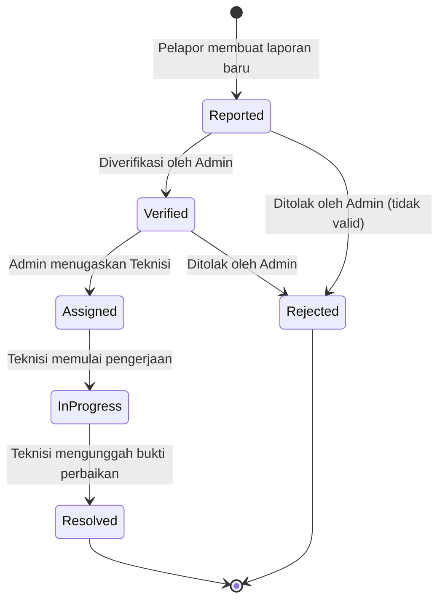

# SiFasilitas (Campus Facility Care)

> Sistem pelaporan dan penanganan kerusakan fasilitas kampus berbasis mobile dengan arsitektur multi-peran (*Pelapor*, *Admin Fasilitas*, dan *Teknisi*), didukung verifikasi berbasis QR Code, *smart triage* AI (Gemini), serta *state machine* pelacakan tiket secara terintegrasi.

---

## 📱 Deskripsi Proyek
**SiFasilitas** adalah aplikasi mobile berbasis Flutter dan Google Firebase yang dirancang untuk mendigitalkan dan mengoptimalkan proses penanganan aduan sarana-prasarana kampus. Sistem ini menggantikan proses pelaporan manual dengan alur kerja yang transparan, terukur (berbasis SLA), dan terhindar dari duplikasi tiket.

Aplikasi menerapkan **Role-Based Access Control (RBAC)** dengan 3 peran utama:
1. **Pelapor (Mahasiswa, Dosen, Staf):** Memindai QR Code lokasi fasilitas, mengambil foto kerusakan fisik, mendapatkan rekomendasi kategori dan prioritas otomatis via AI, serta memantau linimasa perbaikan tiket secara *real-time*.
2. **Admin Fasilitas:** Memverifikasi tiket masuk, menolak aduan yang tidak relevan/valid (*Rejected*), memprioritaskan antrean, dan menugaskan tiket kepada teknisi lapangan yang bertugas (*Assigned*).
3. **Teknisi Perbaikan:** Menerima penugasan tugas kerja, memperbarui status pengerjaan ke tahap pengerjaan (*In Progress*), serta menutup tiket (*Resolved*) dengan kewajiban melampirkan foto bukti hasil perbaikan.

> Deskripsi peran di atas adalah target fungsional aplikasi. Bagian mana yang sudah ada kodenya tercantum di [Status Implementasi](#-status-implementasi).

---

## 👥 Anggota Tim & Pembagian Tanggung Jawab

| No | Nama Lengkap | NIM | Peran Utama | Fokus Tanggung Jawab |
|---|---|---|---|---|
| 1 | Wira Hari Pratama | 241402111 | **Project Lead & Core Architecture** | Setup fondasi Flutter & Firebase, perancangan model entitas data, implementasi *state machine engine* & transaksi Firestore, serta standarisasi master data seeder. |
| 2 | Leondo Admiral Purba | 241402053 | **Frontend Dev (Auth & RBAC)** | Implementasi UI & alur autentikasi (Firebase Auth), sistem validasi identitas (NIM/NIP), serta *role-based navigation gate* (Pelapor, Admin, Teknisi). |
| 3 | Aldrik Noel Sianipar | 241402049 | **Frontend Dev (Reporting & Hardware)** | Antarmuka pembuatan tiket laporan, integrasi kamera & kompresi gambar (`image_picker`, `flutter_image_compress`), dan integrasi pemindai QR Code ruangan/aset (`mobile_scanner`). |
| 4 | Rafi Andara Nasution | 241402095 | **Frontend Dev (Tracking & Timeline)** | Antarmuka riwayat aduan, visualisasi tahapan status tiket (*Reported* ➔ *Resolved*), log riwayat perubahan status (*audit trail*), serta konfirmasi penyelesaian oleh pelapor. |
| 5 | Vincent Christian Simbolon | 241402039 | **Frontend Dev (Dashboard Admin/Teknisi)** | Dashboard manajemen antrean tiket masuk bagi Admin & Teknisi: filter kategori & urgensi, alur disposisi teknisi, serta form penyelesaian tiket berlampiran foto sesudah pengerjaan. |
| 6 | Yosia Marcel Simanjuntak | 241402114 | **BaaS, AI Integration & Data Engineer** | Konfigurasi Cloud Firestore, integrasi *Smart AI Classifier* (Google Gemini 2.5 Flash & NLP Heuristic), logika *anti-duplikasi merge*, dan sistem *auto-upvoting* tiket. |

---

## ✅ Status Implementasi

| Komponen | Status | Keterangan |
|---|---|---|
| Autentikasi & RBAC | Ada | `AuthService` (daftar, masuk, lupa password, verifikasi email, ubah nama), layar `screens/auth/`, `screens/profile/`, dan `AuthGate` (navigasi berdasarkan `users/{uid}.role`). |
| Beranda per peran | Placeholder | `PelaporHome`, `AdminDashboard`, `TeknisiDashboard` baru kerangka. Dashboard admin sudah memuat tombol **Isi Data Master**. |
| Mesin tiket (`ReportService`) | Ada, belum dipakai UI | Buat tiket + anti-duplikasi + upvote, ubah status dengan state machine, otorisasi peran, dan audit log. |
| Klasifikasi AI (`AiClassifierService`) | Ada, belum dipakai UI | Gemini 2.5 Flash bila `GEMINI_API_KEY` diberikan; selain itu heuristik kata kunci. |
| Seeder master data | Ada | Aksi manual admin di dashboard admin. |
| Aturan keamanan (`firestore.rules`) | Ada | Perlu di-deploy sendiri (lihat [Deploy Firestore Rules](#5-deploy-firestore-rules)). |
| Pemindai QR (`mobile_scanner`) | Belum | Baru dependensi dan izin kamera (Android `CAMERA`, iOS `NSCameraUsageDescription`). |
| Foto kerusakan (`image_picker`, `flutter_image_compress`) | Belum | Baru dependensi. **Belum ada penyimpanan berkas** (tidak ada `firebase_storage`); `foto_sebelum_url` dan `foto_sesudah_url` harus berisi URL yang sudah tersedia. |
| Daftar/riwayat tiket, timeline log, konfirmasi pelapor | Belum | Rules mengizinkan konfirmasi pelapor (`confirmed_by_reporter`), tetapi belum ada method service maupun UI-nya. |
| Dashboard antrean admin/teknisi | Belum | |

---

## 🔄 Alur Siklus Hidup Tiket (State Machine)

Siklus hidup setiap tiket laporan dikontrol oleh *state machine* ketat pada `ReportService` untuk menjamin integritas alur operasional:



### Penjelasan Status Tiket:
* **`reported` (Reported / Menunggu Verifikasi):** Aduan berhasil dibuat oleh pelapor dan masuk ke dalam antrean sistem.
* **`verified` (Verified / Terverifikasi Admin):** Admin fasilitas memvalidasi kelayakan fisik dan substansi aduan.
* **`assigned` (Assigned / Teknisi Ditugaskan):** Admin menugaskan teknisi spesifik (`assigned_teknisi_uid`) untuk menangani masalah tersebut.
* **`in_progress` (In Progress / Sedang Dikerjakan):** Teknisi mengonfirmasi bahwa penanganan di lapangan sedang berlangsung.
* **`resolved` (Resolved / Selesai Diperbaiki):** Perbaikan tuntas dan teknisi mengunggah foto bukti penyelesaian (`foto_sesudah_url`).
* **`rejected` (Rejected / Ditolak):** Laporan dibatalkan/ditolak oleh admin disertai alasan tertulis.

### Siapa yang Boleh Mengubah Status

| Status tujuan | Aktor | Syarat tambahan |
|---|---|---|
| `verified` | Admin | |
| `rejected` | Admin | `catatan` (alasan) wajib diisi |
| `assigned` | Admin | `assignedTeknisiUid` wajib dan harus akun berperan `teknisi` |
| `in_progress` | Teknisi yang ditugaskan pada tiket | |
| `resolved` | Teknisi yang ditugaskan pada tiket | `fotoSesudahUrl` wajib |
| `reported` | Tidak ada | Hanya terjadi saat tiket dibuat |

Aturan ini ditegakkan dua kali: di `ReportService` (`canChangeStatus`, `isValidTransition`) dan di `firestore.rules`.

---

## 💡 Fitur Utama Sistem

### 1. Smart Triage & AI Classifier (`AiClassifierService`)
* Memanggil **Google Gemini 2.5 Flash API** untuk menganalisis deskripsi keluhan bila `GEMINI_API_KEY` diberikan lewat `--dart-define` (batas waktu 8 detik). Cara memberikannya ada di [Menjalankan Aplikasi](#6-menjalankan-aplikasi).
* Menentukan kategori fasilitas (AC, Proyektor, Jaringan, Lampu, Toilet, Ruang Kelas) dan tingkat prioritas (*rendah*, *sedang*, *tinggi*, *darurat*). Target SLA mengikuti kategori yang dipilih (`target_sla_jam`), bukan dihitung oleh AI.
* Bila kunci tidak diberikan, perangkat sedang offline, kuota API habis, atau permintaan melewati batas waktu, klasifikasi beralih ke **heuristik kata kunci lokal**. Hasilnya lebih sederhana dan kurang akurat daripada Gemini.

### 2. QR Code Scanner Ruangan & Aset (`mobile_scanner`) — *belum ada UI*
* Menggantikan GPS konvensional yang kerap tidak presisi di area dalam gedung (*indoor*) dan bertingkat.
* Mahasiswa memindai QR Code yang tertera pada pintu ruangan atau stiker aset (contoh: `QR-GDA-101` untuk Gedung A R.101) untuk memastikan akurasi lokasi fasilitas tanpa salah ketik. Nilai QR dicocokkan dengan `locations/{id}.kode_ruangan`.

### 3. Deteksi Anti-Duplikasi & Auto-Upvoting
* Setiap pasangan lokasi + kategori hanya boleh punya satu tiket aktif. Pengecekan dan pembuatan tiket terjadi dalam **satu transaksi Firestore** lewat dokumen kunci `active_tickets/{locationId}_{categoryId}`, sehingga dua pelapor yang bersamaan tidak bisa membuat dua tiket aktif yang sama.
* Jika keluhan sudah pernah dilaporkan dan masih berstatus aktif (*Reported*, *Verified*, *Assigned*, atau *In Progress*), laporan baru otomatis digabungkan (*merged*) dan akun pelapor didaftarkan sebagai pendukung tiket tersebut (+1 Upvote). Pelapor yang sudah tercatat sebagai pendukung tidak dihitung dua kali (`already_supported`).
* Dokumen kunci dihapus dalam transaksi yang sama saat tiket menjadi *Resolved* atau *Rejected*; kunci basi (tiket hilang atau sudah selesai) otomatis ditimpa tiket baru.

### 4. SLA (Service Level Agreement) Tracking
Setiap kategori fasilitas memiliki target batas waktu penanganan (`sla_deadline` = jam perangkat saat laporan dibuat + `target_sla_jam`):
* ⚡ **Lampu & Kelistrikan:** Darurat (Target SLA: 2 Jam)
* ❄️ **AC & Pendingin Ruangan:** Tinggi (Target SLA: 6 Jam)
* 📽️ **Proyektor & Presentasi:** Tinggi (Target SLA: 4 Jam)
* 📶 **Jaringan Wi-Fi & LAN:** Tinggi (Target SLA: 4 Jam)
* 🚰 **Toilet & Sanitasi:** Sedang (Target SLA: 8 Jam)
* 🪑 **Ruang Kelas (Inventaris):** Rendah (Target SLA: 24 Jam)

### 5. Atomic Audit Trail Logging
Setiap mutasi status laporan dicatat ke sub-koleksi `reports/{reportId}/logs` dalam transaksi yang sama dengan perubahan status. Log mendokumentasikan:
* ID & nama aktor pengubah status
* Peran aktor (*Admin*, *Teknisi*, atau *Pelapor* untuk log awal pembuatan tiket)
* Status sebelum dan status sesudah
* Catatan pengerjaan atau verifikasi
* *Timestamp* server: `created_at` dipaksa sama dengan `request.time` oleh `firestore.rules`, sehingga tidak bisa diisi dengan jam perangkat

Rules juga memastikan log hanya bisa dibuat oleh aktor yang berwenang atas perubahan status tersebut (atau pelapor yang membuat tiket, untuk log awal), dan tidak bisa diubah atau dihapus setelah dibuat.

---

## 🗄️ Skema Basis Data (Cloud Firestore)

```text
Firestore Root
├── categories/ {categoryId}
│   ├── id: string (e.g. "cat_ac")
│   ├── nama_objek: string
│   ├── prioritas_default: string ("rendah" | "sedang" | "tinggi" | "darurat")
│   └── target_sla_jam: number
│
├── locations/ {locationId}
│   ├── id: string (e.g. "loc_r101")
│   ├── kode_ruangan: string (e.g. "QR-GDA-101")
│   ├── nama_gedung: string
│   ├── nama_ruangan: string
│   └── lantai: number
│
├── users/ {uid}                          # uid = Firebase Auth UID
│   ├── nama: string
│   ├── identity_number: string           # NIM (9 digit) / NIP (18 digit)
│   ├── email: string
│   ├── sub_role: string ("mahasiswa" | "dosen" | "staf" | "admin" | "teknisi")
│   ├── role: string ("pelapor" | "admin" | "teknisi")
│   ├── fcm_tokens: string[]              # diisi kosong saat daftar; belum dipakai
│   └── created_at: Timestamp (server)
│
├── active_tickets/ {locationId}_{categoryId}   # kunci anti-duplikasi, 1 tiket aktif per lokasi+kategori
│   ├── report_id: string                 # ID dokumen di reports/
│   ├── location_id: string
│   ├── category_id: string
│   └── created_at: Timestamp (server)
│
└── reports/ {reportId}
    ├── ticket_number: string (format "TKT-YYYYMMDD-XXXXXX": tanggal jam perangkat + 6 karakter pertama {reportId}, e.g. "TKT-20261117-aB3xK9")
    ├── reporter_uid: string
    ├── reporter_name: string
    ├── reporter_sub_role: string ("mahasiswa" | "dosen" | "staf")
    ├── location_id: string
    ├── kode_ruangan: string
    ├── nama_gedung: string
    ├── nama_ruangan: string
    ├── category_id: string
    ├── nama_objek: string
    ├── prioritas: string
    ├── target_sla_jam: number
    ├── deskripsi: string
    ├── foto_sebelum_url: string
    ├── foto_sesudah_url: string | null
    ├── status: string ("reported" | "verified" | "assigned" | "in_progress" | "resolved" | "rejected")
    ├── assigned_teknisi_uid: string | null
    ├── assigned_teknisi_nama: string | null
    ├── upvotes_count: number
    ├── confirmed_by_reporter: boolean
    ├── created_at: Timestamp (server)
    ├── sla_deadline: Timestamp           # jam perangkat saat dibuat + target_sla_jam
    ├── updated_at: Timestamp (server)
    │
    ├── [subcollection] supporters/ {userUid}
    │   ├── user_uid: string
    │   ├── nama: string
    │   └── created_at: Timestamp (server)
    │
    └── [subcollection] logs/ {logId}
        ├── actor_uid: string
        ├── actor_nama: string
        ├── actor_role: string
        ├── status_lama: string | null
        ├── status_baru: string
        ├── catatan: string
        └── created_at: Timestamp (server, == request.time)
```

### Ringkasan Aturan Keamanan (`firestore.rules`)

Role pengguna selalu dibaca dari `users/{uid}.role`, bukan dari data kiriman klien.

| Koleksi | Baca | Tulis |
|---|---|---|
| `categories`, `locations` | Pengguna login | Admin |
| `users/{uid}` | Pemilik akun, atau admin | **Buat:** pemilik, hanya `role: pelapor` dengan `sub_role` `mahasiswa`/`dosen`/`staf`. **Ubah:** pemilik (tanpa mengubah `role` dan `sub_role`), atau admin untuk akun lain. **Hapus:** tidak ada. |
| `active_tickets` | Pengguna login | Hanya bersamaan dengan tiket yang dibuat atau diselesaikan (lewat `ReportService`) |
| `reports` | Pengguna login | **Buat:** pelapor, kondisi awal baku. **Ubah:** admin/teknisi sesuai tabel peran, upvote +1, konfirmasi oleh pelapor asli. **Hapus:** tidak ada. |
| `reports/*/supporters` | Pengguna login | Pemilik, dibuat sekali |
| `reports/*/logs` | Pengguna login | Aktor berwenang, `created_at == request.time`, tidak bisa diubah atau dihapus |

---

## 🧩 Kontrak `ReportService` (untuk tim UI)

`ReportService()` memakai `FirebaseFirestore.instance`, jadi baru boleh dibuat setelah `Firebase.initializeApp` (sudah dilakukan di `main.dart`).

```dart
final service = ReportService();

// Buat laporan, atau gabung ke tiket aktif yang sama (+1 upvote).
final hasil = await service.submitReport(
  reporter: appUser,              // AppUser dari AuthService.watchAppUser
  location: lokasi,               // CampusLocation
  category: kategori,             // FacilityCategory
  deskripsi: 'AC tidak dingin',
  fotoSebelumUrl: 'https://...',
  aiSuggestedPriority: 'tinggi',  // opsional; default = prioritas_default kategori
);
// hasil['merged'] (bool), hasil['ticket_number'], hasil['message'],
// hasil['already_supported'] (hanya ada bila merged == true)

// Ubah status tiket.
await service.updateReportStatus(
  reportId: reportId,
  actorUid: auth.currentUser!.uid,  // hanya UID; role & nama dibaca dari users/{uid}
  newStatus: ReportStatus.assigned,
  catatan: 'Ditugaskan ke teknisi gedung A',
  assignedTeknisiUid: teknisiUid,   // wajib & hanya untuk assigned
  fotoSesudahUrl: null,             // wajib untuk resolved
);
```

| Anggota | Keterangan |
|---|---|
| `Future<Map<String, dynamic>> submitReport({reporter, location, category, deskripsi, fotoSebelumUrl, aiSuggestedPriority})` | Satu transaksi: cek kunci `active_tickets`, lalu merge-upvote atau buat tiket + supporter + log awal + kunci. |
| `Future<void> updateReportStatus({reportId, actorUid, newStatus, catatan, assignedTeknisiUid, fotoSesudahUrl})` | Satu transaksi: otorisasi peran, validasi transisi dan parameter, update tiket, hapus kunci (bila `resolved`/`rejected`), tulis log. |
| `static bool isValidTransition(ReportStatus current, ReportStatus next)` | Transisi sah menurut state machine. |
| `static bool canChangeStatus({role, actorUid, newStatus, currentAssignedUid})` | Tabel peran untuk mengubah status (untuk menampilkan/menyembunyikan tombol di UI). |
| `static String activeTicketKey(String locationId, String categoryId)` | ID dokumen `active_tickets`. |
| `static String ticketNumberFor(DateTime date, String reportId)` | Nomor tiket `TKT-YYYYMMDD-XXXXXX`. |

Catatan:
* **Perubahan dari versi lama:** `updateReportStatus` kini menerima `actorUid` (String), bukan `actor: AppUser`, dan parameter `assignedTeknisiNama` dihapus (nama teknisi diambil dari `users/{assignedTeknisiUid}`). Kode yang masih memakai signature lama tidak akan lolos kompilasi.
* Pelanggaran aturan dilaporkan sebagai `Exception` dengan pesan berawalan `403 Forbidden:` (tidak berwenang) atau `422 ...` (transisi/validasi gagal); tiket yang tidak ada: `Laporan tidak ditemukan.`
* Transaksi Firestore membutuhkan koneksi; saat offline akan gagal.

---

## 🛠️ Tech Stack & Dependensi

* **Platform & SDK:** Flutter **≥ 3.35** (Dart `^3.9.2`, lihat `pubspec.yaml`). Diuji dengan Flutter 3.35.3 / Dart 3.9.2.
* **Backend as a Service (BaaS):**
  * `firebase_core: ^5.1.0` - Inisialisasi Firebase App
  * `firebase_auth: ^7.0.1` - Autentikasi Pengguna
  * `cloud_firestore: ^7.1.0` - Database Real-Time NoSQL
* **State Management:**
  * `provider: ^6.1.5+1` - Pengelolaan State Aplikasi (saat ini menyediakan `AuthService`)
* **Network & Intelligence:**
  * `http: ^1.6.0` - Komunikasi REST API ke Google Gemini 2.5 Flash
* **Terpasang, belum dipakai di kode:**
  * `mobile_scanner: ^7.4.2` - Pemindai Barcode/QR Code Ruangan & Aset
  * `image_picker: ^1.2.2` - Pengambilan Gambar dari Kamera & Galeri
  * `flutter_image_compress: ^2.5.1` - Kompresi Foto sebelum Pengunggahan
  * `intl: ^0.20.3` - Format tanggal/waktu di UI

---

## 📁 Struktur Direktori

```
.
├── firebase.json                      # Konfigurasi Firebase CLI (rules Firestore) & FlutterFire
├── firestore.rules                    # Aturan keamanan Cloud Firestore
├── pubspec.yaml
├── android/ ios/ linux/ macos/ web/   # Proyek platform (android/app/google-services.json sudah ter-commit)
├── lib/
│   ├── firebase_options.dart          # Konfigurasi platform Firebase (FlutterFire CLI)
│   ├── main.dart                      # Entry point: init Firebase, MultiProvider, AuthGate
│   ├── models/
│   │   └── report_models.dart         # AppUser, CampusLocation, FacilityCategory, enum UserRole & ReportStatus
│   ├── screens/
│   │   ├── auth_gate.dart             # Navigasi berbasis peran (login / verifikasi email / beranda per role)
│   │   ├── auth/                      # login, register, lupa password, verifikasi email
│   │   ├── home/                      # pelapor_home, admin_dashboard, teknisi_dashboard, role_home_scaffold (masih placeholder)
│   │   └── profile/
│   │       └── profile_screen.dart    # Lihat profil, ubah nama, keluar
│   ├── services/
│   │   ├── ai_classifier_service.dart # Klasifikasi AI (Gemini 2.5 Flash) + heuristik lokal
│   │   ├── auth_service.dart          # Firebase Auth + profil users/{uid}
│   │   ├── firebase_seeder.dart       # Seeder master data (6 kategori & 10 lokasi), dipicu manual admin
│   │   └── report_service.dart        # State machine, anti-duplikasi, transaksi laporan, audit log
│   ├── utils/
│   │   └── validators.dart            # Validator form (email kampus, NIM/NIP, password)
│   └── widgets/
│       ├── loading_button.dart
│       └── seed_master_data_button.dart  # Tombol "Isi Data Master" di dashboard admin
└── test/
    ├── firebase_seeder_test.dart
    ├── report_service_test.dart
    ├── seed_master_data_button_test.dart
    ├── validators_test.dart
    └── widget_test.dart
```

---

## 🚀 Panduan Memulai (Getting Started)

### 1. Prasyarat
* [Flutter SDK](https://docs.flutter.dev/get-started/install) **versi minimal 3.35** (membawa Dart 3.9.2; versi lebih lama gagal pada `flutter pub get`)
* Android Studio / Xcode dengan emulator atau perangkat fisik (diperlukan kamera untuk QR Scanner)
* [Firebase CLI](https://firebase.google.com/docs/cli) (`npm install -g firebase-tools`) dan akses ke proyek Firebase `sifasilitas-kampus`, untuk men-deploy `firestore.rules`
* Konfigurasi Firebase sudah ada di repo: `lib/firebase_options.dart` dan `android/app/google-services.json`. `GoogleService-Info.plist` tidak diperlukan (inisialisasi lewat `firebase_options.dart`; berkas itu masuk `.gitignore`).

### 2. Instalasi Dependensi
Jalankan perintah berikut di terminal root proyek:
```bash
flutter pub get
```

### 3. Membuat Akun Admin & Teknisi
Pendaftaran di aplikasi hanya menghasilkan akun **pelapor** dengan email kampus (`@students.usu.ac.id` atau `@usu.ac.id`) dan `sub_role` `mahasiswa`/`dosen`/`staf`. `firestore.rules` menolak pendaftaran atau perubahan role/sub_role mandiri selain itu, jadi akun admin dan teknisi **harus** disiapkan lewat Firebase Console. Admin pertama pun harus dibuat dengan cara ini.

**Cara A, dari akun yang sudah mendaftar:**
1. Daftar lewat aplikasi seperti pelapor biasa.
2. Buka Firebase Console → Firestore Database → `users/{uid}` milik akun itu.
3. Ubah `role` menjadi `admin` atau `teknisi`, dan `sub_role` dengan nilai yang sama (`admin` / `teknisi`).
4. `AuthGate` mengikuti perubahan secara real-time; akun langsung diarahkan ke dashboard sesuai role. Verifikasi email hanya diwajibkan untuk pelapor.

**Cara B, tanpa mendaftar di aplikasi (email bebas):**
1. Firebase Console → Authentication → Add user (email + password).
2. Firestore → buat dokumen `users/{uid}` dengan ID = UID akun tersebut dan field: `nama` (string), `identity_number` (string), `email` (string), `role` (`admin`/`teknisi`), `sub_role` (`admin`/`teknisi`), `created_at` (timestamp).
3. Tanpa dokumen `users/{uid}`, akun yang masuk akan melihat layar "Profil akun tidak ditemukan".

### 4. Pengisian Data Awal (Master Data Seeder)
Master data (6 kategori fasilitas dan 10 lokasi/QR code ruangan) diisi **manual, sekali jalan, oleh admin**. Seeder tidak dipanggil otomatis dari `main()`, karena `firestore.rules` hanya mengizinkan admin menulis koleksi `categories` dan `locations`.

1. Deploy rules ([langkah 5](#5-deploy-firestore-rules)).
2. Siapkan akun admin ([langkah 3](#3-membuat-akun-admin--teknisi)).
3. Masuk sebagai admin, buka **Dashboard Admin**, tekan **Isi Data Master** lalu konfirmasi.

`FirebaseSeeder.seedMasterDataIfNeeded()` memeriksa `categories` dan `locations` secara terpisah: koleksi yang sudah berisi dilewati, sehingga aman dijalankan ulang.

### 5. Deploy Firestore Rules
Repo belum memiliki `.firebaserc`, jadi proyek harus disebut eksplisit:
```bash
firebase login
firebase deploy --only firestore:rules --project sifasilitas-kampus
```
Untuk hanya memeriksa sintaks tanpa merilis apa pun, tambahkan `--dry-run`. Rules harus di-deploy ulang setiap kali `firestore.rules` berubah; aplikasi tidak akan bisa menulis `categories`, `locations`, atau log tiket dengan benar sebelum rules terbaru aktif.

### 6. Menjalankan Aplikasi
```bash
flutter run --dart-define=GEMINI_API_KEY=<kunci-gemini-anda>
```
`GEMINI_API_KEY` dibaca saat build lewat `String.fromEnvironment` (`AiClassifierService`). Tanpa kunci ini aplikasi tetap berjalan dan memakai heuristik kata kunci lokal.

Agar kunci tidak tertinggal di riwayat shell, simpan di `env.json` (sudah di-`.gitignore`) lalu jalankan dengan `--dart-define-from-file`:
```json
{ "GEMINI_API_KEY": "<kunci-gemini-anda>" }
```
```bash
flutter run --dart-define-from-file=env.json
```
Kunci yang diberikan lewat `--dart-define` ikut tertanam di berkas aplikasi hasil build, jadi jangan membagikan build yang memuat kunci pribadi dan jangan pernah meng-commit kunci tersebut.

### 7. Menjalankan Test
```bash
flutter analyze
flutter test
```
